# Camera Perception for Formula Student Driverless

[](https://github.com/FS-Driverless/Formula-Student-Driverless-Simulator)
[](https://docs.ros.org/en/jazzy/)
[](https://docs.ultralytics.com/models/yolo26/)
[](https://pytorch.org/)
[](https://foxglove.dev/)
[](https://www.python.org/)
[](LICENSE)

This repository rebuilds the two camera pipelines of AMZ's redundant perception system (Gosala et al.,
[arXiv:1809.10099](https://arxiv.org/abs/1809.10099)) in the Formula Student Driverless Simulator and evaluates each
of their stages against the simulator's ground truth. A YOLO26 detector, trained on FSOCO and fine-tuned on
automatically labelled simulator images, finds the cones in the image. The mono pipeline then regresses the seven
keypoints of Dhall et al. on every small cone it detects and solves for the position of an upright cone, while the
stereo pipeline projects each cone into the right image, matches ORB features between the two views and triangulates
them. Both pipelines run as ROS 2 nodes during a recorded 10 lap race and are scored against the true track
afterwards.

The implementation departs from the papers in a few places: it uses a newer detector, ORB instead of SIFT and an
upright cone model instead of PnP with RANSAC, and it takes pose, velocity and driving from the simulator rather
than from a state estimator and SLAM. The redundancy that the paper is about, meaning that the car keeps driving
when one sensor fails, also needs the LiDAR pipeline, which isn't built yet, so that part has not been tested.

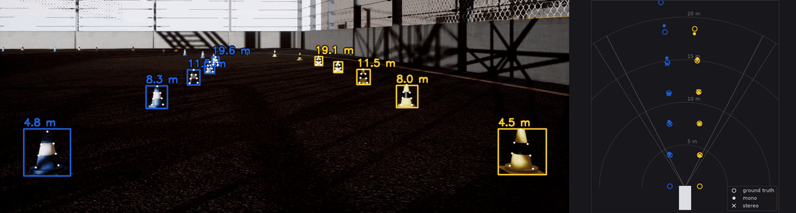

*Five seconds of the race on CompetitionMap3. Left: the mono camera with the detector's boxes, the keypoints and the
distance the mono pipeline found. Right: the true cones around the car (rings) and the cones the mono (dots) and
the stereo node (crosses) published for the same frame.*

## Contents

[Summary](#summary) | [Pipelines](#pipelines) | [Results](#results) | [Latency](#latency) | [Evaluation](#evaluation) | [Reproduce](#reproduce) | [Repository](#repository) | [Limitations](#limitations) | [References](#references)

## Summary

The table puts the main results next to the numbers reported for AMZ's car. They were not measured under the same
conditions: AMZ's come from real images, their own test sets and, for the map, a pose estimated by their SLAM,
while everything here apart from the first row comes from the simulator with the ground truth pose. The comparison
is only a rough orientation, and the simulator numbers should be better.

| | AMZ, real car | here |
|---|---|---|
| detector on real images | precision 0.84, recall 0.71 | 0.92 / 0.85 on FSOCO cameras it never saw |
| keypoint network | 3.78 px^2 on their test crops | 1.72 px^2 on simulator crops |
| mono position error | about 0.5 m at 10 m, 1 m at 16 m | median 0.08 m at 5-10 m, 0.30 m at 15-20 m |
| stereo against mono | triangulated depth scatters less than PnP | range spread 0.04 m against 0.13 m at 5-10 m |
| cone map from stereo | 0.25 m RMSE with their SLAM | 0.03 m with the ground truth pose |

The detector row is YOLO26s trained on FSOCO alone, scored on the three classes Dhall et al. used. The pipelines
use a version fine-tuned on simulator images, which reaches 0.84 / 0.68 on the same FSOCO cameras. There is no
published FSOCO benchmark to compare with, since the FSOCO paper only plots its baseline on a test set that isn't
public, so this row is a rough comparison.

## Pipelines

### Detection

FSOCO is converted to YOLO format and split by the camera that recorded each image rather than by
folder, because the folders belong to the teams that labelled the images, and splitting by folder would put frames
of the same recording into both train and test. YOLO26s is trained on it at 1280 px and then fine-tuned on
simulator images that are labelled automatically. For that, a depth image is rendered together with every camera
image and each pixel is back-projected into the scene, so that the pixels falling inside a cone's volume give a
tight box, along with how much of the cone is visible and how well it stands out from the background. YOLO26n
and m were trained and fine-tuned the same way for comparison. Within 20 m every size finds practically all
cones of the simulator test map (at least 99.5%), but n misses more of the distant ones, and m finds a few more
than s for about 1 ms more per image.

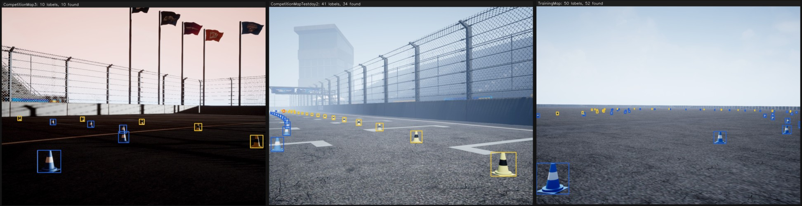

*The detector on three simulator maps: automatic labels in white, what it found in the cone colours.*

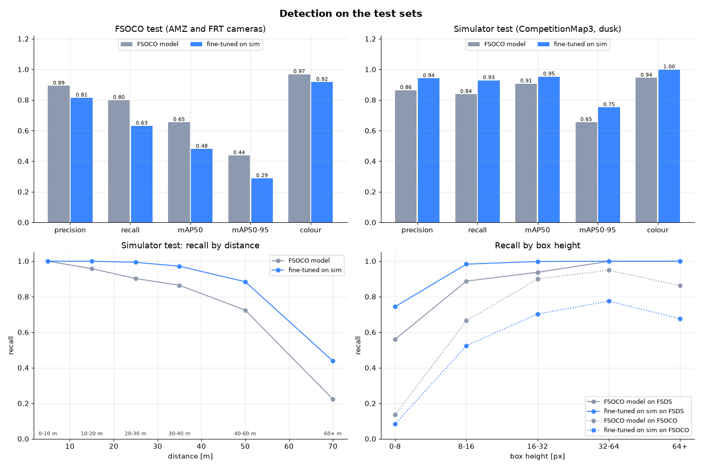

*Both detectors on the held-out FSOCO cameras and on the held-out simulator map. The fine-tuned model is the one
the pipelines use; it gains on the simulator and loses recall on real cones.*

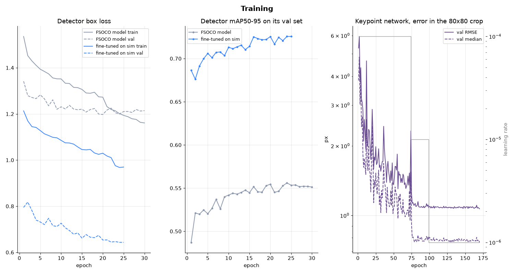

### Mono

Each detection is cut out and resized to 80x80 pixels, and a small residual network regresses the seven
keypoints on it, trained with the cross-ratio term of Dhall et al. in its loss. The cone model the keypoints are
matched against was measured in the simulator instead of being taken from the rules, since FSDS cones are 1.5 cm
shorter. Rather than solving the full pose with PnP inside RANSAC, the cone is assumed to stand upright, which leaves
only the position of its base to be found. With noisy keypoints a full pose tends to tilt the cone and places
distant cones about 0.3 m too close, whereas the upright model has no such bias. Boxes touching the left or right
border of the image are skipped, because the keypoints of a cone that is only partly visible are not reliable.

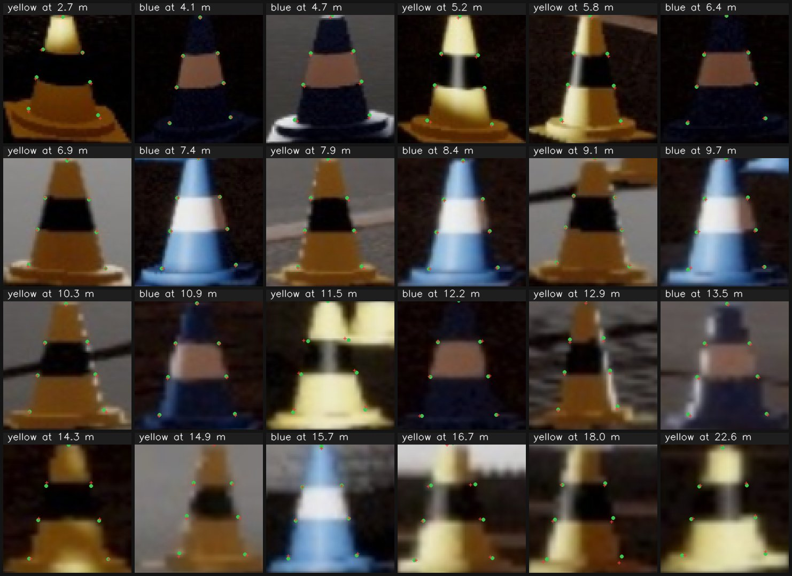

*Test crops of the unseen dusk map, from near to far: true keypoints in green, the network's in red.*

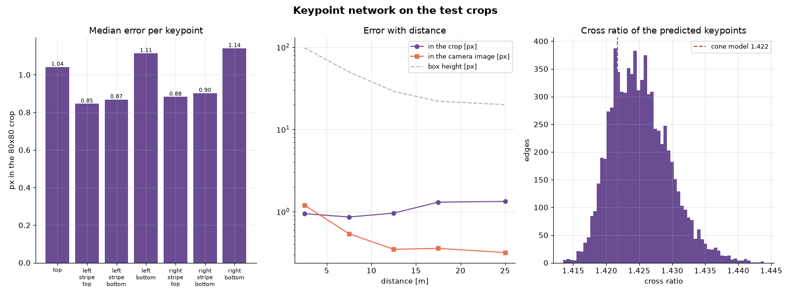

### Stereo

The mono estimate of each cone is projected into the right camera to get a search box there. ORB
features (the paper used SIFT) are matched between the box in the left image and the search box and then
triangulated, and the median of the points that lie on the cone gives its position. The paper stopped at 10 m,
here stereo reports cones up to 20 m like mono.

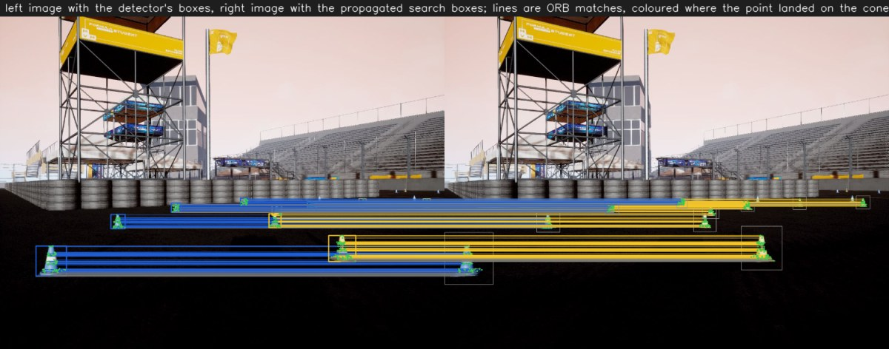

## Results

On a simulator map that was held out from training, with the detector's boxes and the full pipelines, the cone
positions come out as follows (on the cones where both pipelines gave a position):

| distance | mono median | stereo median | mono range spread | stereo range spread |
|---|---|---|---|---|
| 0-5 m | 0.06 m | 0.03 m | 0.09 m | 0.03 m |
| 5-10 m | 0.08 m | 0.04 m | 0.13 m | 0.04 m |
| 10-15 m | 0.16 m | 0.07 m | 0.27 m | 0.11 m |
| 15-20 m | 0.31 m | 0.11 m | 0.40 m | 0.20 m |

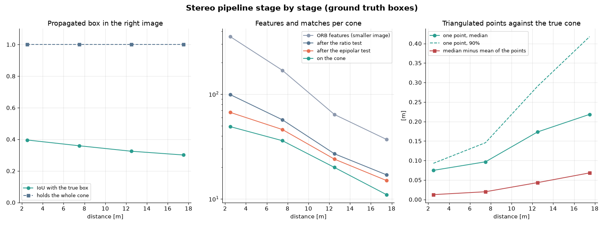

*The stereo stages on their own: the propagated search box, the matches, how far a single triangulated point lies
from the cone, and how much closer the median of all points on the cone gets.*

Almost all of the error lies along the line of sight, and across it both pipelines stay within 0.04 m. Gosala et
al. show the distance error for a standing car in their Fig. 9a, and the plot below makes the same comparison while
driving:

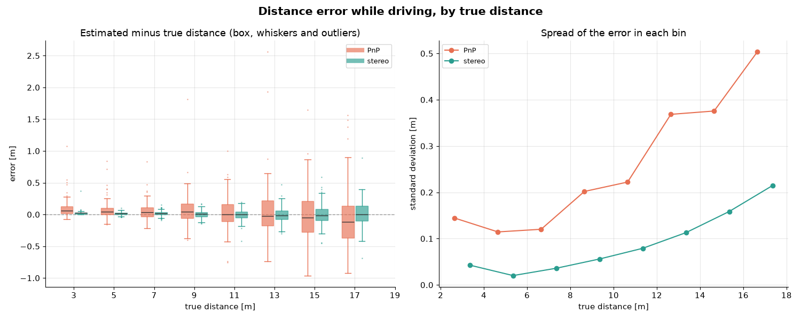

The next table is from a live 10 lap race on CompetitionMap3, a map none of the models was trained on, with both
pipelines sharing one GPU:

| | rate | latency median / p95 | recall | precision | RMSE 0-5 m | 5-10 m | 10-15 m | 15-20 m |
|---|---|---|---|---|---|---|---|---|
| mono | 13.5 Hz | 35 / 41 ms | 0.93 | 0.98 | 0.10 m | 0.14 m | 0.26 m | 0.41 m |
| stereo | 13.5 Hz | 53 / 62 ms | 0.85 | 1.00 | 0.04 m | 0.05 m | 0.12 m | 0.20 m |

Both pipelines report cones up to 20 m. The cameras delivered about 13.5 images per second in this race, and both
pipelines processed nearly all of them. Mono's recall is lower close to the car (0.77 below 5 m) because cones cut
off by the image border are skipped, although the scoring still counts them as expected. Stereo finds 0.98 to 0.99
of the cones up to 15 m but only 0.38 at 15 to 20 m: its search box in the right image comes from the mono
estimate, which needs keypoints, and on the wider left camera a cone's box falls below the 20 px the keypoint
network needs at about 16 m. The far cones it does find are placed with half of mono's error. A cone counts as
found within 1 m of its true position. With a gate of 0.5 m, the accuracy Strobel et al. (2020) require, stereo
loses almost nothing (0.84 / 0.99 overall), while mono drops to 0.86 / 0.91 overall and to 0.68 / 0.70 at 15 to
20 m, where its position error comes close to the gate.

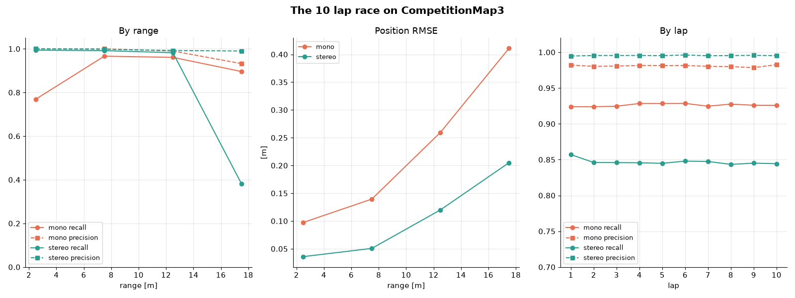

Accumulating all cones of the race into a map, using the ground truth pose, gives an RMSE of 0.14 m for mono and
0.03 m for stereo, with the colour of every cone correct. AMZ's 0.25 m includes the error of their own pose, which
they measured at 0.2 m RMSE against a laser reference.

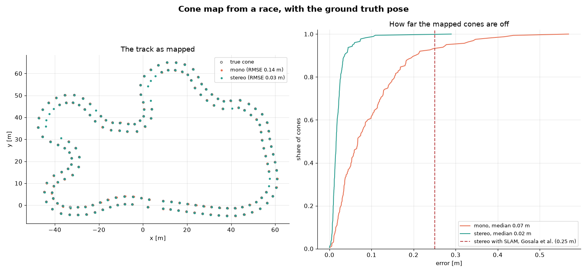

## Latency

Two limits apply to the camera pipelines. They have to keep up with the cameras, so a frame has to be finished
before the next one arrives, which is 74 ms at the 13.5 images per second of the race. The latency, the time until
the cones of an image are available to the rest of the car, may be longer than that because the frames are
processed one after another, and it is limited by how far the car travels in the meantime. Strobel et al. (2020)
derive a perception budget of 200 ms from an emergency stop at 25 m/s, and AMZ found that the roughly 300 ms
between detecting a cone and the control command reaching the car limited their top speed (Kabzan et al. 2020).

`make latency` times every stage of both pipelines on the held-out map (190 frames on an RTX 5070 Ti, with the
images already decoded):

| | p50 | p99 | biggest stage | cost per box beyond the detector |
|---|---|---|---|---|
| mono | 9.6 ms | 13.5 ms | detector 4.3 ms | 0.3 ms |
| stereo | 23.2 ms | 31.8 ms | ORB matching 9.6 ms | 1.7 ms |
| both, back to back | 33.3 ms | 42.3 ms | | |

The detector runs in half precision and through `torch.compile` with CUDA graphs. A single 1280 px image is too
little work to keep the GPU busy, so in plain PyTorch most of the time goes into launching kernels: the detector
alone takes 7.6 ms in full precision, 6.9 ms in half precision and 3.8 ms once it is also compiled. As a TensorRT
engine in half precision it takes 3.1 ms with the same boxes as full precision, and in INT8 2.6 ms but with 8% fewer
boxes. In the pipelines the fp16 engine saves about 1.6 ms per frame at the median and 2.3 ms at p99 (both
pipelines 31.7 against 33.3 ms and 40.0 against 42.3 ms), so they stay with PyTorch, which needs nothing outside the
locked environment; `scripts/export_engine.py` builds the engine, and every script and node takes it as the
detector (`reports/tensorrt/`). On the same machine these benchmarks move by up to 2 ms from one day to the next.
Both pipelines back to back stay well within a frame of the cameras.

In the race, the time from the image stamp to the published cones was 35 ms for mono and 53 ms for stereo at the
median, and 41 and 62 ms at p95. The per-stage timing that both nodes record shows where it goes: the simulator's
bridge needs 13 ms from the stamp to publishing a 3.7 MB image (18 ms at p95), DDS transport, queueing and
deserialisation add about 5 ms, stereo waits up to 9 ms (p95) for the partner image, and since both pipelines share
the GPU with each other and with the simulator, the detector takes 7.3 to 8.4 ms instead of 4.3. An earlier recording of
the race had 71 and 89 ms at p95, because the bridge held back about one image in eight for another 40 ms. That was
Nagle's algorithm on the simulator's RPC socket waiting for a delayed acknowledgement; `scripts/sim.sh` now
switches it off and `record_run.sh` gives DDS a shared memory segment large enough for a whole image
([docs/notes/simulator-notes.md](docs/notes/simulator-notes.md) has the measurements, `reports/archive/` the
earlier race).

These latencies start at the simulator's stamp, which it sets after rendering, and end when the cones are
published, so they leave out parts that published numbers of real systems include. Andresen et al. (2020) measured
25 ms of camera latency before their 65 ms of cone detection, and the under 180 ms of Strobel et al. (2020) run
from the moment a cone comes into view, including the wait for the next frame, which made up 28% of their total.
Adding 25 ms for a camera and half a frame on average (37 ms at 13.5 images per second) gives about 100 ms for mono
and 115 ms for stereo at the median on that definition, within the 200 ms budget.

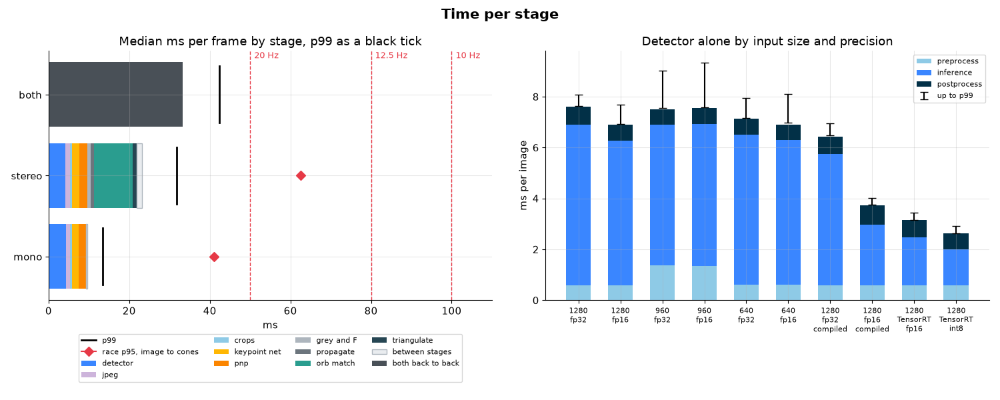

## Evaluation

Each stage has its own report, figure and Foxglove tab, so that a number that looks wrong can be traced back to
the step that produced it: the datasets, detection, keypoints, the mono positions, the stereo sub-steps
(propagation, matching, triangulation), the race and the map. During a race both nodes also publish how long each
stage took for every frame, and the race report breaks this down. [docs/evaluation.md](docs/evaluation.md) is the
index, [docs/walkthrough.md](docs/walkthrough.md) runs the whole camera pipeline one command at a time, and
[docs/tour.md](docs/tour.md) is a guide to reading the code.

`scripts/build_results.py` collects everything into a single file for Foxglove. It contains one lap of the race
with the boxes, keypoints, search boxes and matches drawn onto the images, the triangulated points in 3D, recall and
error per image as plots, a table with what every stage made of each cone, and 18 figures.

## Reproduce

Setting up, the tests, and every number and figure that doesn't need the simulator, once the datasets and models
exist ([docs/walkthrough.md](docs/walkthrough.md) builds them step by step; the latency benchmark wants the GPU to
itself):

```bash
make venv && make build && make test
make evaluate
make latency
```

The published race (`runs/live_competitionmap3_10laps`) takes about 11 minutes and 3.7 GB (10 laps at 5 m/s on
CompetitionMap3). Scoring and the map need ROS sourced, and the last command builds the Foxglove file:

```bash
scripts/record_run.sh --settings configs/fsds/gotthard.json --map Competition/CompetitionMap3 --speed 5 \
    --mono --stereo --laps 10 --name race
source /opt/ros/jazzy/setup.bash && source install/setup.bash
uv run scripts/score_run.py runs/race --pipeline mono
uv run scripts/score_run.py runs/race --pipeline stereo
uv run scripts/build_map.py runs/race
uv run scripts/build_results.py --race runs/race
```

Datasets and training are described in [docs/detection.md](docs/detection.md), the pipelines in
[docs/mono.md](docs/mono.md) and [docs/stereo.md](docs/stereo.md), and the simulator setup in
[docs/setup.md](docs/setup.md).

## Repository

- `src/driverless_perception/` is a Python package without any ROS dependency: common types and the camera model,
  the simulator interface, the vision pipelines (detection, keypoints, mono, stereo), evaluation and visualisation.
- `ros/` has thin ROS 2 packages for the messages, the pipeline nodes, the ground truth side and recording, and the
  launch files.
- `scripts/` has one entry point per step, from preparing the datasets to building the results file.
- `configs/` holds the simulator settings, the dataset splits and the training configs.
- `docs/` explains how each part works, `docs/design-decisions.md` why it is built that way, and `docs/notes/`
  collects what was found out about the simulator, the papers and the datasets.
- `reports/` has what every evaluation produced, as markdown and JSON.

## Limitations

- All numbers come from the simulator with the ground truth pose, so they will be better than on a real car. The
  relations between the stages are more likely to carry over than the absolute values.
- The redundancy experiment of the paper, with sensors failing during a run, has not been done. It needs the LiDAR
  pipeline, which isn't built yet. Once it is, the cone colour will come from the camera image (the early fusion of
  Andresen et al. 2020), since FSDS provides no LiDAR intensity.
- The pipelines use YOLO26s because it finds more of the distant cones than n (recall at 40 to 60 m 0.88 against
  0.81), but they only use cones up to 20 m, where both find all of them. The extra range would only matter for a
  module that uses cones further away.
- Fine-tuning on simulator images makes the detector worse on real cones (FSOCO recall drops from 0.80 to 0.63),
  and training on both datasets together has not been tried yet.
- Stereo only finds about a third of the cones at 15 to 20 m, because its search box needs the mono estimate and
  the left camera's boxes get too small for keypoints beyond about 16 m. A search box from the detector's box
  alone, with a rough distance from its height, would extend it.
- Both pipelines share one GPU with each other and with the simulator, so in the race the detector takes almost
  twice as long as alone, and the simulator's bridge still needs about 13 ms to hand over each image.
- The networks were trained on JPEG captures only, and on the raw images in a race the keypoints placed distant
  cones about 0.2 m too far away. As a workaround the nodes take the keypoints from a JPEG-compressed copy of each
  box, but training data cut from the uncompressed render would be the proper fix.

## References

- N. Gosala et al., *Redundant Perception and State Estimation for Reliable Autonomous Racing*, ICRA 2019
  ([arXiv:1809.10099](https://arxiv.org/abs/1809.10099))
- A. Dhall et al., *Real-time 3D Traffic Cone Detection for Autonomous Driving*, IV 2019
  ([arXiv:1902.02394](https://arxiv.org/abs/1902.02394))
- J. Kabzan et al., *AMZ Driverless: The Full Autonomous Racing System*, JFR 2020
  ([arXiv:1905.05150](https://arxiv.org/abs/1905.05150))
- L. Andresen et al., *Accurate Mapping and Planning for Autonomous Racing*, IROS 2020
  ([arXiv:2003.05266](https://arxiv.org/abs/2003.05266))
- K. Strobel et al., *Accurate, Low-Latency Visual Perception for Autonomous Racing: Challenges, Mechanisms, and
  Practical Solutions*, 2020 ([arXiv:2007.13971](https://arxiv.org/abs/2007.13971))
- N. Vodisch et al., *FSOCO: The Formula Student Objects in Context Dataset*, SAE Int. J. of CAV 2022
  ([arXiv:2012.07139](https://arxiv.org/abs/2012.07139))
- [FSOCO dataset](https://www.fsoco-dataset.com/) | [Formula Student Driverless Simulator](https://github.com/FS-Driverless/Formula-Student-Driverless-Simulator)

MIT licensed, see [LICENSE](LICENSE).
